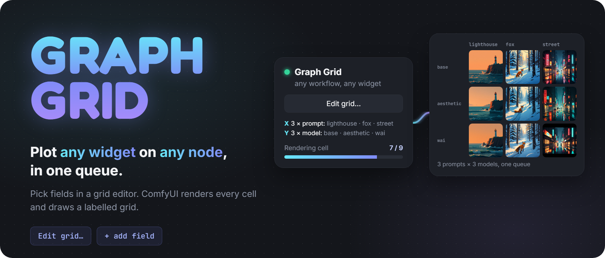
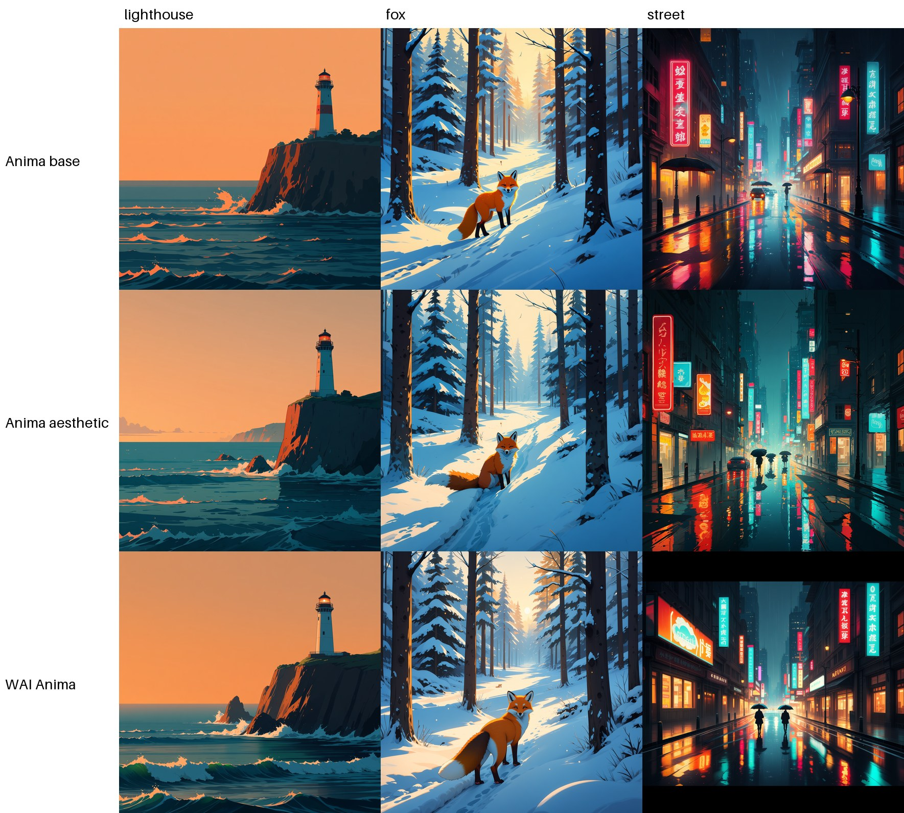
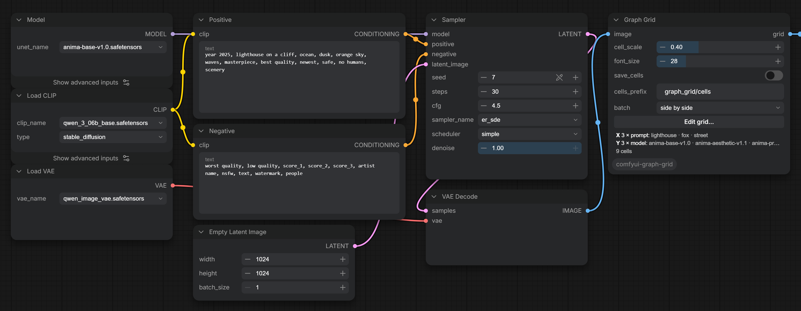
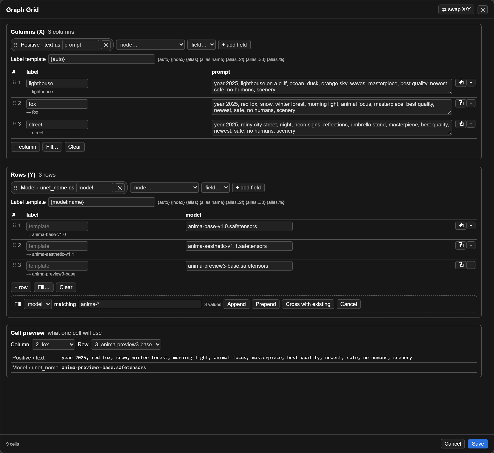
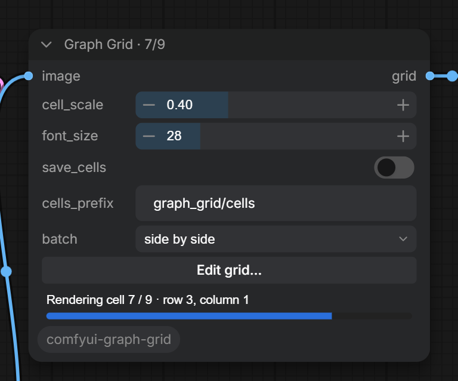

<p align="center"></p>

# Graph Grid

**Why:** compare settings side by side: LoRAs and their strengths, prompts, samplers, CFG, checkpoints, anything with a widget.

**How:** connect the image you want to compare to a **Graph Grid** node, click **Edit grid…**, pick the fields to vary and list their values. One queue renders every cell and draws a labelled grid.

<p align="center"></p>

It works with any workflow. There is no special loader or sampler: the node copies the part of your graph that each cell changes and lets ComfyUI run the copies, so nodes no cell touches (model loaders, text encoders) load once and identical cells come from cache.

## Install

**ComfyUI Manager:** open **Custom Nodes Manager**, search for **Graph Grid**, install, and restart ComfyUI.

**comfy-cli:**

```
comfy node install comfyui-graph-grid
```

**Manually:** clone into `ComfyUI/custom_nodes` and restart ComfyUI:

```
git clone https://github.com/Mr-Quin/comfyui-graph-grid
```

Tested on ComfyUI 0.41.0. Labels need Pillow 10.1 or newer, which current ComfyUI already installs; older versions place them wrongly.

## Use

1. Add the **Graph Grid** node and connect your final image (VAE Decode output) to its `image` input. Connect its `grid` output to a Save Image or Preview Image node.

<p align="center"></p>

2. Click **Edit grid…**. For columns and for rows:
   - **+ add field**: pick a node that feeds the image and one of its widgets. Add several fields to change more than one thing per row or column.
   - **+ column / + row** adds an entry. A blank cell leaves the widget unchanged.
   - **Fill…** generates entries: a number range, a wildcard over a dropdown's options (`*epoch[468]*`), or one value per line. *Append*, *Prepend*, or *Cross with existing* (every existing entry times every value).
   - Drag the ⠿ handle to reorder fields and entries.
   - **Cell preview** at the bottom: pick a column and a row to see the exact values that cell will use, with `{v}` filled in.

<p align="center"></p>

3. Queue. The node counts the cells as they finish (also in its title, so you can follow it zoomed out), and the grid appears in the Save Image or Preview Image node.

<p align="center"></p>

Try `example_workflows/scenery_by_model.json` for a finished setup. It uses the [Anima](https://huggingface.co/circlestone-labs/Anima) models: `anima-base-v1.0`, `anima-aesthetic-v1.1` and `anima-preview3-base` in `models/diffusion_models`, `qwen_3_06b_base` in `models/text_encoders` and `qwen_image_vae` in `models/vae`. Any other model works the same way; pick your own files in the Model node and in the grid's rows.

### Values

| Write | Means |
| --- | --- |
| *(blank)* | keep the widget's value |
| `""` | an empty string |
| `watercolor, {v}` | `{v}` is the widget's value before this override, so this prepends text |

Column overrides are applied before row overrides, so a row's `{v}` sees the column's value.

### Other node packs

Any widget on any node works, including custom nodes. Some widgets hold an object or a list instead of a single value; their parts show up as separate fields:

| Node | Field to vary |
| --- | --- |
| rgthree Power Lora Loader | `lora_1.lora`, `lora_1.strength`, `lora_1.on` |
| LoRA Manager Lora Loader | `loras.0.strength`, `loras.0.active` (the node ignores its visible `text` box, so vary `loras`) |
| Easy-Use LoRA Stack | `lora_1_name`, `lora_1_strength` |

### Labels

Each axis has a label template, and each entry can override it.

| Template | Gives |
| --- | --- |
| `{auto}` | the values that entry sets, shortened (default) |
| `{index}` | 1, 2, 3, … |
| `{lora}` | a field's value, by its alias |
| `{lora:name}` | a file name without folder or extension |
| `{strength:.2f}`, `{strength:g}`, `{strength:%}` | number formats |
| `{prompt:.30}` | the first 30 characters |

### Node options

| Option | |
| --- | --- |
| `cell_scale` | size of each cell in the grid, relative to the image |
| `font_size` | label size |
| `save_cells` | also save every cell at full size, named by row, column and labels |
| `cells_prefix` | folder and file prefix for those cells, inside ComfyUI's output folder |
| `batch` | cells with several images: *side by side*, *first image*, or *animate* (one grid per frame; connect a video or animated save node) |

## Limits

- Only widgets on nodes upstream of the image can vary. A widget that is wired to another node can't; vary that node instead.
- Other output nodes in the workflow (another Save Image, say) still run once with the unchanged values.
- Nodes that read the whole prompt through hidden inputs see the original prompt, not the cell's copy.
- The grid stores node ids. Copying a Graph Grid node into another workflow or renumbering nodes breaks its fields; re-pick them.
- Graph Grid nodes can't be nested.
- Labels use Pillow's built-in font, which has no CJK or emoji glyphs.
- Grids over about 100 megapixels, or animated grids over 4 GB in memory, are refused; lower `cell_scale` or use fewer cells or frames.
- An axis holds at most 256 entries, and Fill adds at most 1000 values at a time.

## License

GPL-3.0, see [LICENSE](LICENSE).
